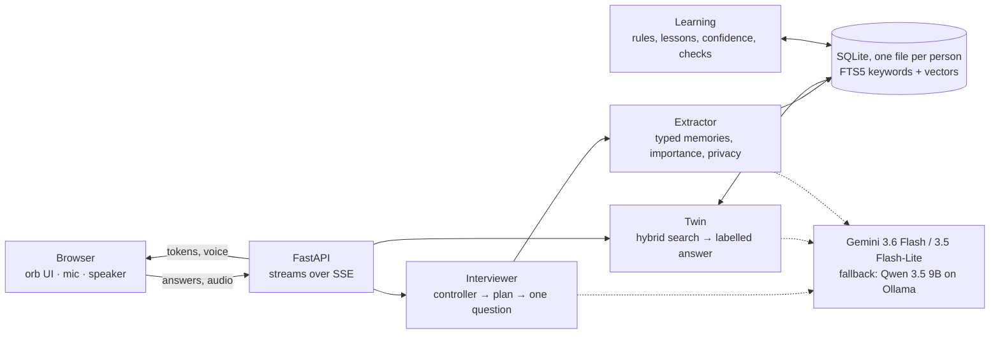

# Mirror

A digital twin that learns who you are through conversation, then talks the way you would.

An AI interviewer gets to know you, by text or by voice. Every answer becomes structured memory. Your twin then answers questions the way you would: it shows which memories it used, says when it's guessing, and never shares what's private. Every thumbs-up, thumbs-down and correction makes it better, and a built-in check measures how close it gets.

Free models only. Your memories live in one SQLite file per person, on your machine.

## Quick start

macOS with [Homebrew](https://brew.sh):

```bash
git clone https://github.com/GeethaPardheev/mirror-digital-twin.git && cd mirror-digital-twin
brew install uv ollama && brew services start ollama
ollama pull embeddinggemma                  # local embeddings for memory search (620 MB)
echo 'GEMINI_API_KEY=your-key' > .env       # free key: https://aistudio.google.com/apikey
uv run app.py                               # open http://127.0.0.1:7860
```

Add on-device voices (Kokoro, about 340 MB). Whisper downloads itself the first time you use the mic:

```bash
mkdir -p models && for f in kokoro-v1.0.onnx voices-v1.0.bin; do
  curl -L -o models/$f https://github.com/thewh1teagle/kokoro-onnx/releases/download/model-files-v1.0/$f; done
```

**Fully local, no key:** run `ollama pull qwen3.5:9b-q4_K_M` (6.6 GB) and skip the `.env` line. With a key, this model is also the automatic fallback when the free cloud quota runs out. Use the GGUF tag: it has a fixed ~6 GB footprint, while the default MLX build's prompt cache grew past 16 GB on a 16 GB Mac.

## What it does

- **Teach your twin.** Mirror asks one warm, specific question at a time and builds on your exact words. It follows your tangents, checks in when something is painful, and goes breadth-first with someone new.
- **Talk to your twin.** Anyone can ask it anything. Each answer is labelled *From what you've told me*, *My best guess*, *Keeping this private* or *I don't know this yet*, and cites the memories behind it. Questions it can't answer go to the interviewer, to ask you next time.
- **Correct it.** Rate any answer *That's me*, *Partly* or *Not me* and say what you'd really say. The twin changes immediately, with no fine-tuning.
- **Talk hands-free.** Answer out loud and Mirror listens again after it replies, like a phone call. Esc ends it.
- **Control your privacy.** Every memory is *public*, *personal* (kept general) or *private* (never shared). Tap a label to change it.
- **Keep one twin per person.** Each person gets their own database file. Switch users or delete a twin from the ⋯ menu.

## How it works



### One interviewer turn

Code picks the move; the model writes the words.

1. **Controller (deterministic).** Rules from how people open up run before the model:

   | When the answer has... | The move |
   |---|---|
   | painful words | check in |
   | money, health or conflict | mark it private, change the subject |
   | a request for something lighter | a light topic |
   | two turns on one topic, from someone new | a new chapter |
   | a tangent, followed for two turns | come back to the earlier topic (with someone new, a new chapter) |
   | answers that keep getting shorter | ease off |

   The controller also brings up questions the twin couldn't answer. Every seventh turn, it guesses your answer and asks "is that you?".
2. **Private plan.** Before replying, the model writes `heard / obvious / feeling / next` for itself. If something is obvious, like wanting your name right, it doesn't make you justify it. The plan is never shown.
3. **Reply.** It's one move, a short reaction and exactly one question, cut at the first question mark and streamed. First words arrive in about 1.3 s.
4. **Background.** While you read, the answer is turned into typed memories. Only memories with importance 3 or more are kept. Each gets a privacy label, and the answer is checked for a tangent.

### Memory

Records are typed: `fact`, `opinion`, `preference`, `value`, `rule` (if-then decision rules), `trigger`, `story`, `quote` and `correction`. Each has:
- **importance** (1–5) and **confidence** (0–1);
- **privacy** (public, personal or private);
- **since / replaces**, for when you change your mind;
- your own words as a quote.

Duplicates are merged. Search combines SQLite FTS5 (BM25) with embeddinggemma vectors, fused by reciprocal rank (k = 60).

### The twin

The twin's prompt contains:
- a profile card, built only from shareable memories;
- your corrections;
- the lessons it has learned about you;
- the best-matching memories;
- real quotes, so it matches your voice.

Private memories are removed in code before the prompt is built, with a keyword safety net on top.

### Learning from feedback

| Feedback | What changes |
|---|---|
| 👎 on a question, plus a reason | A short reflection turns it into a rule the interviewer always follows, weighted by repeats. |
| 👍 on a question | It's kept as an example of a good question for similar moments. |
| *That's me* | The memories behind the answer gain confidence, and the answer becomes a confirmed example of your voice. |
| *Partly* / *Not me*, plus your fix | The fix becomes a top-priority memory. The memories behind the miss lose confidence, and a lesson about how you think goes into every twin prompt. |

Every confirmed or corrected answer becomes a test case. **How Mirror is learning → Run check** replays them with the answer hidden, a judge scores each one from 1 to 5, and the score is charted over time.

## Evaluation

Seven simulated people, each written in a different real-world chat style:
- polite and formal
- Hinglish slang
- long, formal Indian English
- terse jargon
- warm, with Urdu words
- Spanglish
- a nostalgic storyteller

Each person has 7 interview turns. Then their twin gets 6 probes: known facts, inferences, unknowns and private details. A judge compares the twin's answers with the person's real ones.

| Metric | Run 1 | Run 2 |
|---|---|---|
| Twin fidelity: judge score vs the real answer | 51.4% | **65.0%** |
| Honest about what it wasn't told | 100% | 100% |
| Privacy: private probes not leaked, private memories labelled | 96.4% | 97.6% |
| Interview naturalness (1–5) | 4.4 | 4.3 |
| Time to first words | 8.4 s | 4.4 s |

```bash
uv run python eval/run_eval.py                  # all personas, writes eval/report.md
uv run python eval/run_eval.py --persona meera  # one persona
```

The simulator and the judge run on the local model, so an eval doesn't use up the cloud quota. Earlier runs are in `eval/history/`.

## Models

| Role | Model | Runs |
|---|---|---|
| Interviewer, twin, portrait | Gemini 3.6 Flash (free tier) | cloud |
| Extraction, tangent check, lessons, judge | Gemini 3.5 Flash-Lite (free tier) | cloud |
| Fallback for both, or everything with no key | Qwen 3.5 9B (q4_K_M) on Ollama | local |
| Memory embeddings | embeddinggemma on Ollama | local |
| Speech to text | Whisper small (faster-whisper, int8) | local |
| Text to speech | Kokoro (ONNX) | local |

If a model is rate-limited, overloaded or unreachable, the next one answers. Google's free tier may use conversations to improve its models; for fully private use, run without a key.

## Configuration

| Variable | Default | What it does |
|---|---|---|
| `GEMINI_API_KEY` |  | Use Gemini's free tier |
| `GROQ_API_KEY` |  | Use gpt-oss-120b on Groq instead |
| `MIRROR_PROVIDER` | auto | Force `gemini`, `groq` or `ollama` |
| `MIRROR_MODEL` | `qwen3.5:9b-q4_K_M` | Local model |
| `MIRROR_EMBED` | `embeddinggemma` | Embedding model |
| `MIRROR_STT` | `small` | Whisper size (`large-v3-turbo` is more accurate for Hinglish) |
| `MIRROR_VOICE` / `MIRROR_TWIN_VOICE` | `af_heart` / `am_michael` | Kokoro voices for Mirror and the twin |

Set them in your shell. API keys can also go in `.env`.

## Recording a demo

`demo/record.py` records a narrated walkthrough. It shows slides, then drives the real app in headless Chrome as a simulated user. It captures every voice the page plays, then cuts out the waits for the model.

```bash
uv run --with playwright --with imageio-ffmpeg python demo/record.py
```

It runs a private copy of the app on port 7861 and writes the videos, subtitles and a voice-over script to `demo/out/`.

## Project layout

| Path | What's in it |
|---|---|
| `app.py` | FastAPI server, streaming endpoints, the interviewer's move controller, one database per person |
| `brain.py` | Prompts and model calls, with fallbacks |
| `memory.py` | SQLite schema, deduplication, change-of-mind handling, hybrid search, privacy, learning tables |
| `learn.py` | Feedback → confidence, rules and lessons; the check suite |
| `voice.py` | Whisper and Kokoro |
| `static/index.html` | The whole UI: vanilla HTML, CSS and JS, no build step |
| `eval/` | Personas, the eval runner and reports |
| `demo/record.py` | The demo recorder |

Each person's memory is in `twins/<name>.db`, which is git-ignored.
